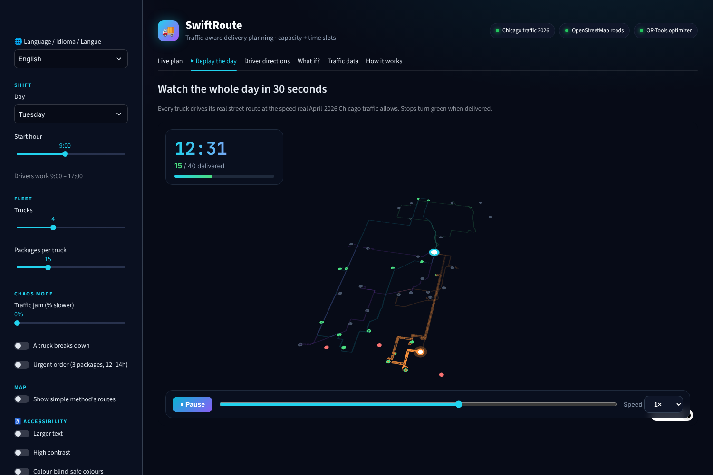
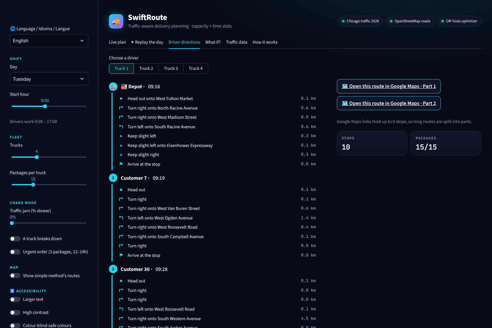
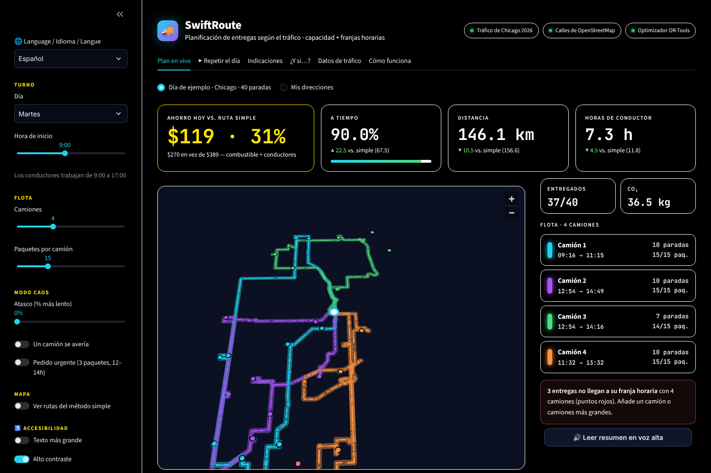

# 🚚 SwiftRoute: delivery routes that survive real traffic

**Live demo:** https://swiftroute-routes.streamlit.app · **DataNova 2026 · Operations Research track · Last-Mile Delivery Route Optimization**

SwiftRoute plans every delivery truck's route around **truck capacity**, **customer time slots** and
**real hourly traffic**, then **replays the whole day against real traffic** to prove the plan holds.


## Features
- 🗺️ **Live plan:** optimized routes on real Chicago streets, cost / on-time / km / driver-hours / CO₂ vs. the simple method
- ▶️ **Replay the day:** animated map, every truck driving its real route at real traffic speed, stops turning green
- 🧭 **Driver directions:** turn-by-turn steps + one tap to **Google Maps**
- 🔥 **Chaos mode:** traffic jam, truck breakdown, urgent order, re-planned in seconds
- 🔮 **What if?:** 6 scenarios (more trucks, bigger trucks, worse traffic, double orders)
- 🎙️📍 **Voice typing & my location** for addresses
- ♿ **Accessibility:** larger text, high contrast, colour-blind-safe colours, reduce motion, read-aloud, keyboard focus, screen-reader map text
- 🌐 **English · Español · Français**

| Replay the day | Driver directions | Español + high contrast |
|---|---|---|
|  |  |  |

## Results (real roads + April 2026 Chicago traffic)

**Robustness, 10 different random days** (40 orders, 4 trucks × 15 packages, `validate.py`):
SwiftRoute was **cheaper on 10/10 days** and **more on time on 10/10 days**:
mean **−32.6% cost** (range −15.7% to −51.1%) and **+23.8 points on time** (+12.5 to +32.5).
It also **delivered at least as many orders every day** (mean 36.5/40 vs 35.2/40), so the savings
don't come from skipping work.

**Scenario analysis** (sample day, `scenarios.py`). *On time* = share of **all** orders, so undelivered stops count against us:

| Scenario | SwiftRoute delivered | on time | cost | Simple delivered | on time | cost |
|---|---|---|---|---|---|---|
| Normal day (4 trucks × 15) | 37/40 | **90.0%** | **$270** | 35/40 | 67.5% | $389 |
| +1 truck | 40/40 | **100%** | **$294** | 40/40 | 75.0% | $439 |
| Traffic 30% worse | 37/40 | **92.5%** | **$319** | 35/40 | 65.0% | $433 |
| Bigger trucks (25 packages) | 40/40 | **100%** | **$274** | 40/40 | 70.0% | $435 |
| Orders double (80 stops) | 43/80 | 52.5% | $252 | 40/80 | 40.0% | $409 |
| Orders double + 4 trucks | 75/80 | **93.8%** | **$488** | 72/80 | 62.5% | $770 |

**About the benchmark:** "Simple" = go to the nearest unvisited stop that still fits in the truck.
It is a *deliberately simple* stand-in for hand-planning, **not a second optimizer**: it respects
capacity but does not plan around closing times; its lateness is measured afterwards in the same replay.

Insight: the fleet is limited by **truck size** more than time, so bigger trucks deliver 40/40, 100% on
time, at almost the same cost.

## How it works
1. **Addresses → map points:** OpenStreetMap Nominatim (typed, spoken, or your location).
2. **Real roads:** distance + empty-road drive time for every pair of stops (OSRM / OpenStreetMap).
3. **Real traffic:** City of Chicago *Traffic Tracker* (`4g9f-3jbs`), **2.66 M speed readings, 1,046 road
   segments, Apr 2–30 2026**. Each segment vs. its own free-flow speed (90th pct.) → slowdown per hour of the week.
4. **Optimizer (expected traffic):** Google OR-Tools VRP with capacity + time windows, minimizing fuel +
   driver cost. The optimizer can't know exact drive times in advance, so each leg uses the traffic of the
   hour we *expect* to leave that stop (middle of its time slot).
5. **Honest check (actual traffic):** every route (ours and the baseline's) is then **replayed minute by
   minute**, each leg slowed by the traffic of the hour it *actually* starts in. All numbers come from the
   replay, so if traffic makes a planned delivery late, it shows up.
6. **Robustness:** if the solver finds no plan, the app says so instead of failing; stops that can't fit
   their time slot are listed as undelivered (red dots) and counted in every KPI.

| File | Purpose |
|---|---|
| `app.py` | Streamlit app (6 tabs) |
| `traffic.py` | Downloads Chicago traffic → hourly slowdown profile |
| `geo.py` | Geocoding, road tables, turn-by-turn routes |
| `solver.py` | OR-Tools optimizer, nearest-stop baseline, KPIs |
| `plan.py` | Pipeline + hour-by-hour traffic replay |
| `replay.py` | Animated "Replay the day" map (deck.gl, bundled in `static/`) |
| `i18n.py` | English / Spanish / French text |
| `scenarios.py`, `validate.py` | Scenario analysis and 10-day robustness test → `results/` |
| `docs/` | Rubric check, pitch script, video plan, screenshots |

Assumptions: 5 min per delivery · $0.60/km · $25/h per driver · 0.25 kg CO₂/km · 8-hour shift.

## Reproduce the results
Every number above is **deterministic**: same seeds, the committed traffic profile (`data/traffic_profile.csv`),
cached road tables (`data/road_cache/`), and a solver that stops after a fixed **1,000 solutions** (not seconds).
Running twice, or on another computer, gives byte-identical CSVs.
```bash
python validate.py          # 10-day robustness test  -> results/validation.csv  (~3 min)
python scenarios.py         # 6 scenarios             -> results/scenarios.csv
pip install pytest && python -m pytest tests -q   # 10 correctness tests (~2 min)
```
The tests check: no stop visited twice, capacity never exceeded, arrivals inside time windows, an order
too big for any truck is left unassigned (not a crash), unassigned orders count against on-time %, a
"no solution" result returns an empty plan, determinism, benchmark capacity, the replay catching lateness,
and orders outside the shift reported as undelivered.

## The model
Vehicle routing with capacity and time windows. **Minimize** $0.60 × km + $25/h × each truck's time out
+ $10,000 × each undelivered order, **subject to** each order served at most once, packages per truck ≤ Q,
time-window open ≤ arrival ≤ close, arrival(j) ≥ arrival(i) + 5 min + drive(i→j), and
drive(i→j) = empty-road time ÷ traffic factor(day, hour). Solved with OR-Tools (path-cheapest-arc start +
guided local search): a strong heuristic, not a proof of optimality.

## Run it
```bash
git clone https://github.com/haricharanparna/swiftroute
cd swiftroute
pip install -r requirements.txt
streamlit run app.py
```
Windows: `py -3.13 -m pip install -r requirements.txt` then `py -3.13 -m streamlit run app.py`.
Voice typing works best in Chrome or Edge; allow the microphone / location when asked.

**Live demo:** https://swiftroute-routes.streamlit.app

## Limitations
- Demo customers are generated (fixed seeds), not real orders.
- Traffic is one city-wide factor per hour from arterial streets (bus-GPS estimates), not per street.
- SwiftRoute sometimes drives more km: it trades distance for fewer driver hours and late deliveries.
- Uses free public OSRM / Nominatim / Google speech servers, fine for demos; production would self-host.

See [docs/RUBRIC_CHECK.md](docs/RUBRIC_CHECK.md) · [docs/PITCH_SCRIPT.md](docs/PITCH_SCRIPT.md) · [docs/VIDEO_PLAN.md](docs/VIDEO_PLAN.md)
