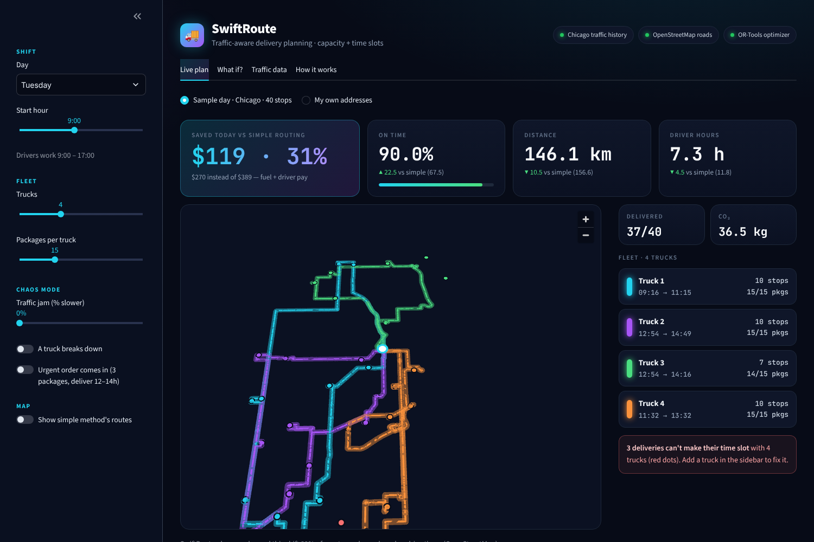
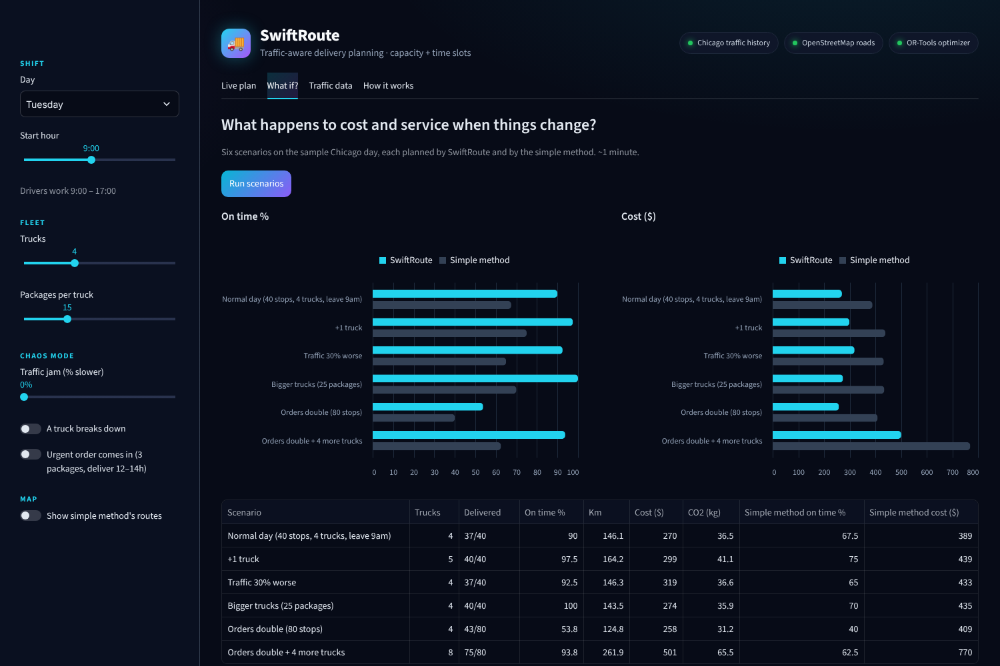
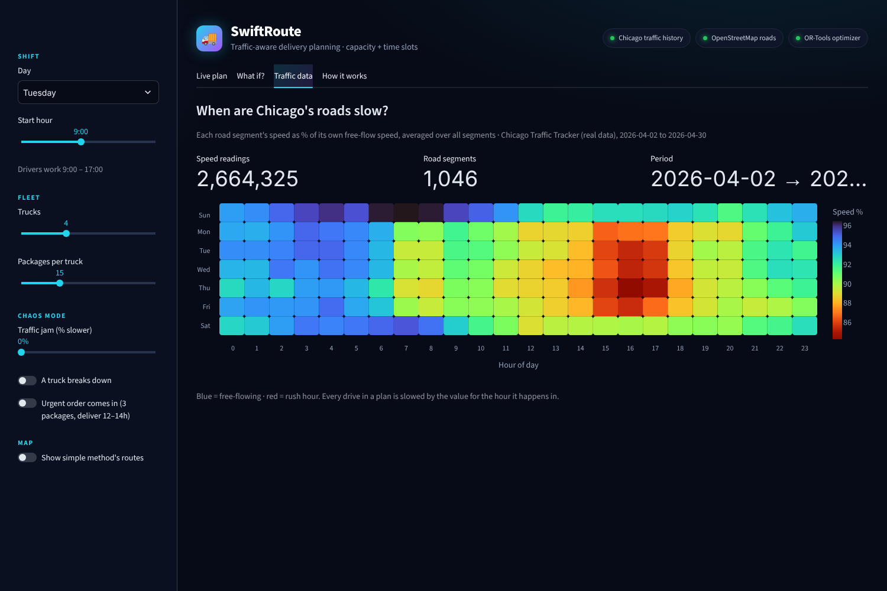

# 🚚 SwiftRoute: traffic-aware last-mile delivery planning

**DataNova 2026, Operations Research track: Last-Mile Delivery Route Optimization**

SwiftRoute plans every delivery truck's route so packages arrive inside each customer's time slot,
for the lowest cost, using **real road networks** and **real traffic history**, and shows the
result on an interactive map.



## Results (sample Chicago day: 40 deliveries, Tuesday 9:00–17:00, real roads + April 2026 traffic)

| Scenario | SwiftRoute on time | Simple method on time | SwiftRoute cost | Simple method cost |
|---|---|---|---|---|
| Normal day (4 trucks × 15 packages) | **90.0%** | 67.5% | **$270** | $389 |
| +1 truck | **97.5%** | 75.0% | **$299** | $439 |
| Traffic 30% worse | **92.5%** | 65.0% | **$319** | $433 |
| Bigger trucks (25 packages) | **100%** | 70.0% | **$274** | $435 |
| Orders double (80 stops) | 53.8% | 40.0% | $258 | $409 |
| Orders double + 4 more trucks | **93.8%** | 62.5% | **$501** | $770 |

"Simple method" = go to the nearest unvisited stop next, which many small fleets do by hand.
On a normal day SwiftRoute is **~31% cheaper and 22.5 points more on time**. The scenarios show the
fleet is limited by **truck capacity** more than by time: bigger trucks reach 100% on time at
almost the same cost.

## How it works

1. **Addresses → map points:** OpenStreetMap (Nominatim).
2. **Real roads:** distance and empty-road drive time between every pair of stops (OSRM on OpenStreetMap).
3. **Traffic:** City of Chicago *Traffic Tracker* (dataset `4g9f-3jbs`): **2.66 M speed readings
   from 1,046 road segments, Apr 2–30 2026**. For each segment we compare its hourly speed with its
   own free-flow speed (90th percentile), then average over all segments → a slowdown factor for
   every hour of the week (`traffic.py`).
4. **Optimization:** Google OR-Tools vehicle routing with **truck capacity** and **customer time slots**,
   minimizing real cost (fuel per km + driver pay per hour). Drive times are time-dependent: a leg is
   slowed by the traffic factor of the hour it is expected to happen in (`solver.py`, `plan.py`).
5. **Check:** every route (ours and the baseline's) is **replayed hour by hour with real traffic**;
   all reported numbers come from that replay, so traffic-caused lateness shows up honestly.
6. **Scenario analysis:** 6 what-if scenarios (`scenarios.py`, also in the app).

| File | Purpose |
|---|---|
| `app.py` | Streamlit app: live plan map, chaos mode, what-if, traffic heatmap |
| `traffic.py` | Downloads Chicago traffic data and builds the hourly slowdown profile |
| `geo.py` | Geocoding, road distances/times, street geometry for the map |
| `solver.py` | OR-Tools optimizer, nearest-stop baseline, KPIs |
| `plan.py` | Ties it together; hour-by-hour traffic replay |
| `scenarios.py` | Scenario analysis → `results/scenarios.csv` |
| `sample.py` | Repeatable sample day (40 or 80 Chicago customers) |

**Assumptions:** 5 min per delivery · $0.60/km · $25/hour per driver · 0.25 kg CO₂/km · 8-hour shift.

## Run it

```bash
git clone https://github.com/haricharanparna/swiftroute
cd swiftroute
pip install -r requirements.txt
streamlit run app.py
```

(On Windows: `py -3.13 -m pip install -r requirements.txt` then `py -3.13 -m streamlit run app.py`.)
The traffic profile is already in `data/`; `python traffic.py` re-downloads it (~2 min).

**Free online demo:** sign in at share.streamlit.io with GitHub → *Create app* → pick this repo,
branch `main`, file `app.py` → *Deploy*.

## Limitations

- The sample day's customers are generated (fixed seed), not real orders.
- Traffic is one city-wide factor per hour, from arterial streets in Chicago (bus GPS estimates);
  it doesn't vary by neighborhood.
- Uses the free public OSRM and Nominatim servers, fine for demos, not for heavy use.



