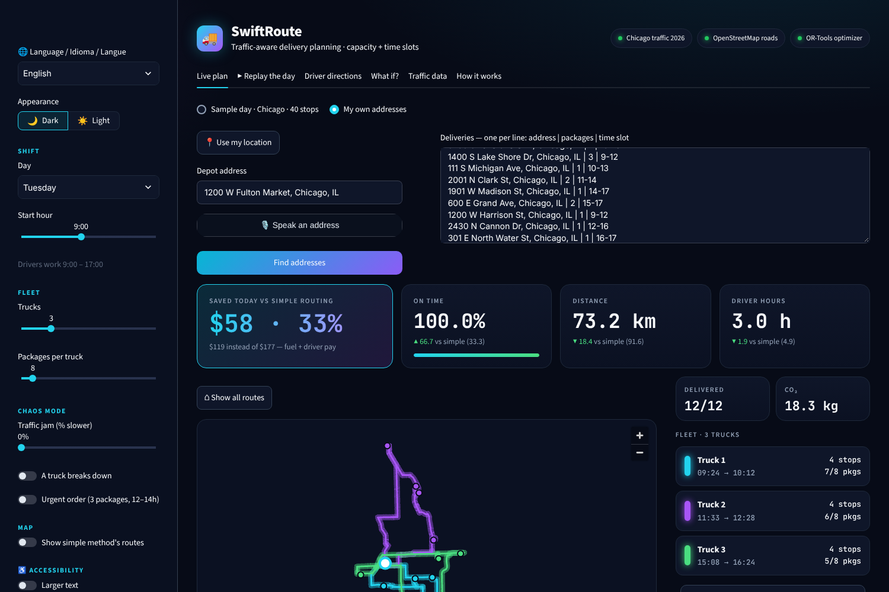
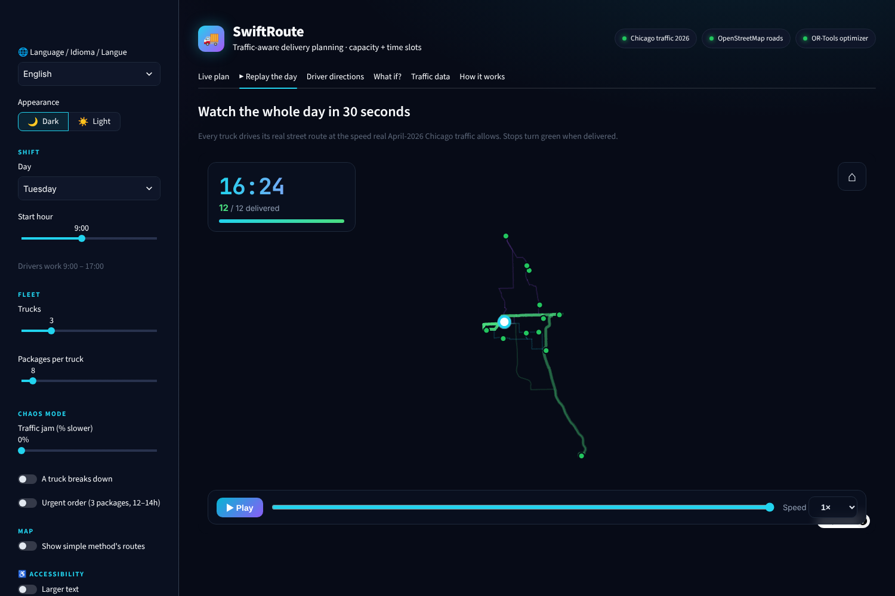

# End-to-end scenario test: "Fulton Flowers"

A realistic day, entered through the app's **My own addresses** screen in a real browser (as a user would),
then the downloaded plan was checked independently against the original orders.

**Setup:** depot 1200 W Fulton Market, Chicago · Tuesday 9:00–17:00 · **3 vans × 8 bouquets** · 18 bouquets, 12 real addresses.
Hard parts on purpose: a far stop in Hyde Park, a 3-bouquet order, a tight 16–17 slot at shift end, a crowded morning.

| Address | Bouquets | Slot |
|---|---|---|
| 233 S Wacker Dr (Willis Tower) | 2 | 9–11 |
| 875 N Michigan Ave | 1 | 10–12 |
| 1060 W Addison St (Wrigley Field) | 2 | 12–15 |
| 5700 S Lake Shore Dr (Museum of Science and Industry) | 1 | 13–16 |
| 1400 S Lake Shore Dr (Field Museum) | 3 | 9–12 |
| 111 S Michigan Ave (Art Institute) | 1 | 10–13 |
| 2001 N Clark St (Lincoln Park Zoo) | 2 | 11–14 |
| 1901 W Madison St (United Center) | 1 | 14–17 |
| 600 E Grand Ave (Navy Pier) | 2 | 15–17 |
| 1200 W Harrison St (UIC) | 1 | 9–12 |
| 2430 N Cannon Dr | 1 | 12–16 |
| 301 E North Water St | 1 | 16–17 |

## Result in the app
All 12 addresses found · **12/12 delivered, 100% on time** (simple method: 33.3%) · **$119 vs $177 (−33%)** ·
73.2 km vs 91.6 km · vans carry 7, 6 and 5 bouquets · replay ends 16:24 with 12/12 delivered.

## Independent checks on the downloaded plan (`results/scenario_florist_plan.csv`): 19/19 passed
- every address visited exactly once (12/12)
- no van over 8 bouquets (7, 6, 5) and package counts match the orders
- every arrival inside its slot (e.g. Willis Tower 9:39 in 9–11; North Water St 16:01 in 16–17)
- each van starts and ends at the depot and its times only move forward

## What we learned
- The tight 16–17 stop was reached at 16:01: the plan waits for slots to open instead of arriving early.
- The model pays drivers only while they are out, so it prefers **three short trips** (≈1 h each) over one long
  one. A real florist might prefer fewer vans; a fixed cost per van would capture that. Noted as a limitation.

